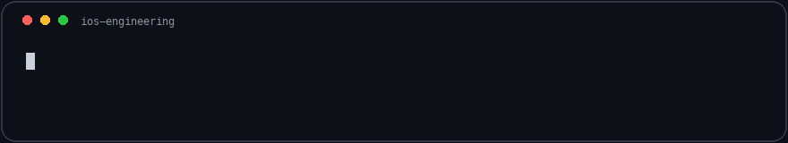
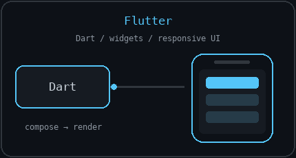
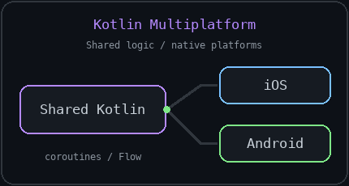
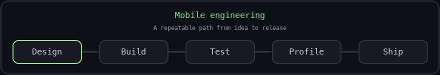

# Edgar Arakelyan

### Senior Mobile Engineer · Yerevan, Armenia

Mobile apps. Clear architecture. Reliable experiences.

## About me

I build native iOS applications with Swift, UIKit, and SwiftUI. My experience spans mobile banking, workforce management, and location tracking, where performance, data consistency, and platform behavior matter as much as the interface.

My mobile engineering focus also includes Flutter and Kotlin Multiplatform (KMM): composing interfaces with Dart and Flutter, sharing business logic between iOS and Android with Kotlin, and keeping platform-specific integrations clear and maintainable.

I enjoy turning complex app requirements into focused modules, making asynchronous code easier to reason about, and tracking down the production issues that only appear on real devices. My work also includes shared app platforms, developer tooling, code reviews, and mentoring.

## What I work on

| Area | Engineering focus |
| --- | --- |
| Architecture | Modular Swift packages, explicit dependency boundaries, reusable foundations across multiple apps |
| Concurrency & data | Structured concurrency, actor isolation, offline synchronization, local persistence |
| Native capabilities | Background location, document capture, on-device face verification, widgets, Live Activities |
| Performance | Memory profiling, camera frame processing, UI responsiveness, battery-aware background work |
| Product delivery | Subscriptions, purchase restoration, automated tests, repeatable releases, production diagnostics |

## Technology toolbox

**Languages & interface**

Swift · SwiftUI · UIKit · Combine · RxSwift

**Android & cross-platform**

Android · Kotlin Multiplatform (KMM) · Flutter

**Flutter focus**

Dart · Widget composition · Responsive layouts · State management · Async programming · REST API integration · Navigation · Unit & widget testing

**Kotlin Multiplatform focus**

Kotlin · Shared business logic · Common & platform-specific modules · Coroutines · Flow · expect/actual declarations · Swift interoperability · Shared-code testing

**Architecture & concurrency**

MVVM · VIPER · Modular architecture · Dependency injection · Swift Package Manager · async/await · Actors · Swift macros

**Networking & persistence**

URLSession · Moya · Realm · Offline synchronization · Keychain

**Apple frameworks & on-device ML**

CoreLocation · Background Tasks · Vision · TensorFlow Lite · WidgetKit · Live Activities

**Backend & monetization**

Firebase Authentication · Cloud Functions · Cloud Storage · Cloud Messaging · Firebase Security Rules · StoreKit 2 · RevenueCat

**Quality & delivery**

XCTest · Instruments · Xcode Memory Graph · Fastlane · GitHub Actions · Xcode Cloud · TestFlight · Crashlytics · Bugfender

## How I approach engineering

- Give each module a clear responsibility and make dependencies visible.
- Treat offline behavior and shared state as design decisions from the start.
- Profile performance and resource use on devices, then improve what the measurements show.
- Use automation to make testing, feature setup, and releases repeatable.
- Keep code reviews practical: correctness, maintainability, and the experience users receive.

---

**Let's connect**

[LinkedIn](https://www.linkedin.com/in/edgar-arakelyan-ios) · [Email](mailto:edgar.araqelyan505@gmail.com)

